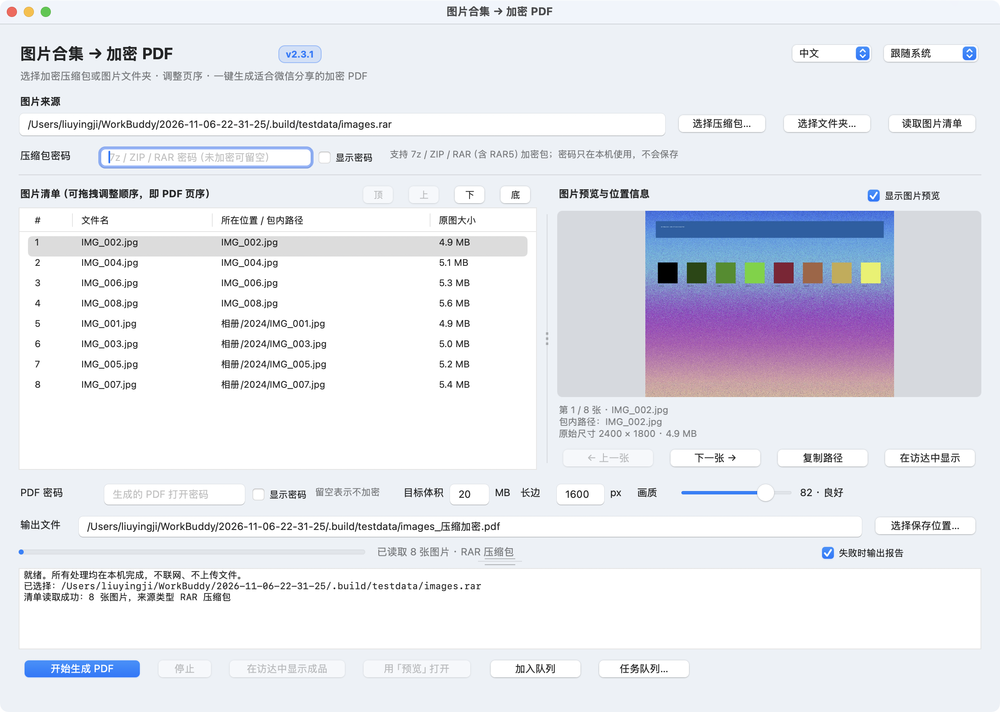
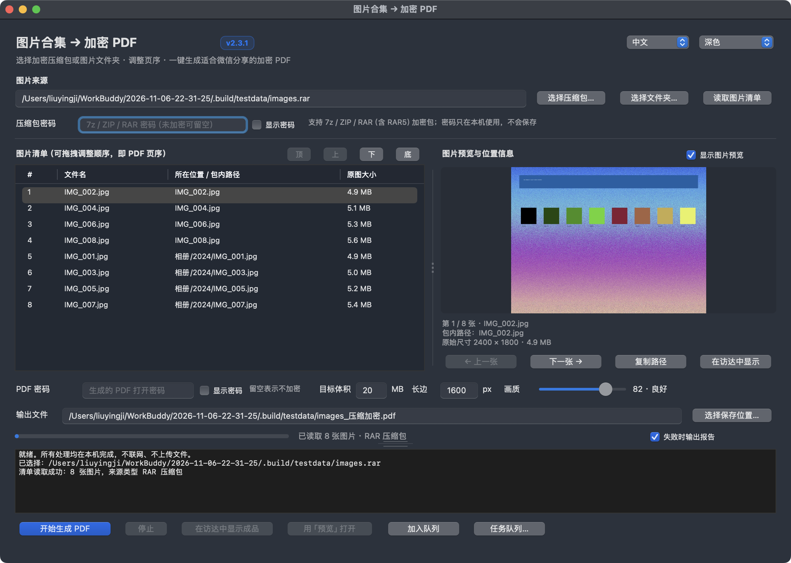
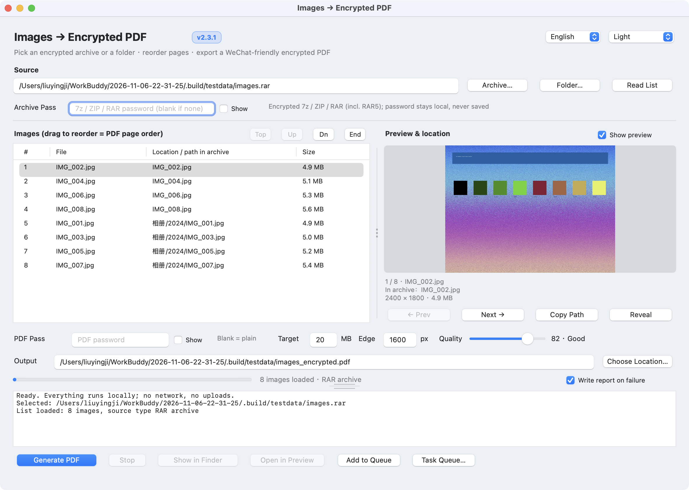
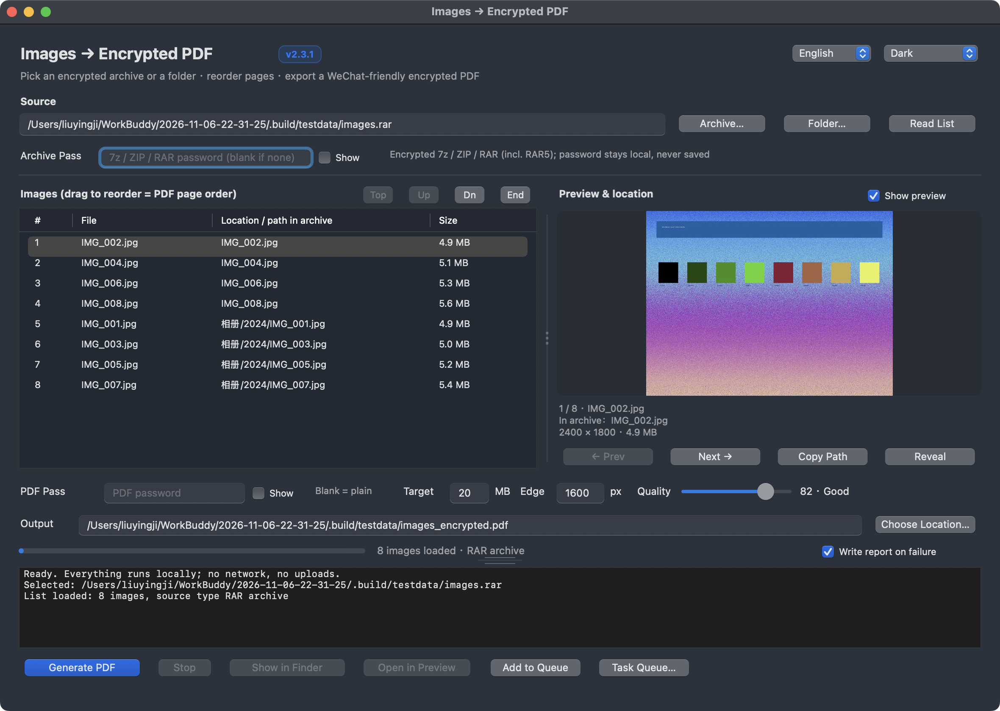
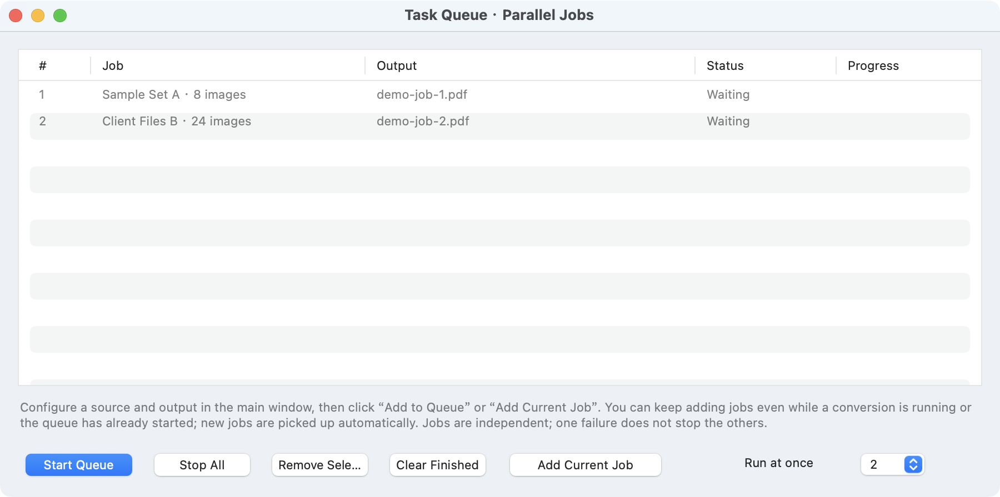
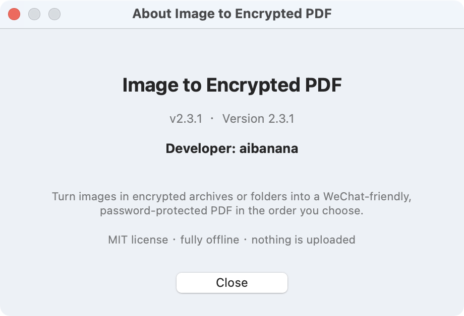

# 图片合集转加密 PDF / Image to Encrypted PDF


[English](#english) · [更新日志](CHANGELOG.md) · [贡献指南](CONTRIBUTING.md) ·
[安全策略](SECURITY.md) · [测试说明](tests/README.md) · [行为准则](CODE_OF_CONDUCT.md)

---

# 中文

一款**纯原生 macOS App**：把加密压缩包里几百张图片，合并成一个体积很小、可加密码的 PDF，
方便用微信分享。全程离线，不上传任何文件。

> 2~3 GB 图片 → 约 20 MB PDF，在你的 Mac 上一分钟内完成。
>
> 语言：中文 / English · 外观：跟随系统 / 浅色 / 深色（都能实时切换并记住）

## 为什么做这个

212 张、2.8 GB 的照片压缩包没法直接发微信，直接转成的 PDF 依旧巨大。
本工具直接读取压缩包，按「目标体积 ÷ 张数」为每张图计算体积预算，
逐张缩放并重编码 JPEG，再无损嵌入 PDF；页面尺寸跟随图片比例（没有 A4 白边），
最后用 AES-256 加密。

界面是 Swift / AppKit，处理引擎是 Go 子进程，两者通过 stdout 的 JSON 行通信。
**不启动浏览器、不启本地 HTTP 服务、不含任何联网代码。**

## 界面截图：中英双语 × 深浅双主题

同一个窗口，四种组合实时切换（右上角两个下拉框）。所有图片都是真实运行截图。

<table>
  <tr>
    <td align="center"><b>中文 · 浅色</b><br></td>
    <td align="center"><b>中文 · 深色</b><br></td>
  </tr>
  <tr>
    <td align="center"><b>English · Light</b><br></td>
    <td align="center"><b>English · Dark</b><br></td>
  </tr>
</table>

切换语言时，整段历史日志、状态栏、表头、关于窗口、输出文件名（中文 `_压缩加密` /
英文 `_encrypted`）都会一起变化；英文界面不出现任何中文字符。

更多窗口：

<table>
  <tr>
    <td align="center"><b>任务队列（多任务并行）</b><br></td>
    <td align="center"><b>关于窗口（版本信息）</b><br></td>
  </tr>
</table>

## 功能

- **加密输入**：直接读取 7z、ZIP（AES）、RAR / RAR5（含文件名加密），密码只在内存中使用。
- **顺序由你定**：清单里拖拽排序，或用移动按钮、右键菜单置顶 / 移动 / 移除 / 反序；清单顺序就是 PDF 页序。
- **预览与位置**：点选可看缩略图（EXIF 自动转正）、原始尺寸、体积、包内完整路径；可复制路径或在 Finder 中显示。预览可以整体关闭。
- **精确控制体积**：填目标 MB，引擎自动二分搜索满足预算的最高 JPEG 画质。
- **并行**：图片处理使用有界工作线程池；「任务队列」窗口还能同时跑多个独立任务（1~4 并发）。
- **容错**：尾部数据不完整的 JPEG 会自动补齐；确实无法修复的图片只跳过自己那一页，不会中断整批任务，并可输出诊断报告。
- **PDF 加密**：纯 Go 实现 PDF 2.0 AES-256（R=6）打开密码。
- **双语与主题**：中文 / English，跟随系统 / 浅色 / 深色；清单—预览分栏、日志区高度都可拖动。
- **版本信息**：主窗口有 `v2.3.1` 版本胶囊，关于窗口显示完整版本号与当前语言的「开发者：aibanana」。

## 安装

从 Releases 下载 `ImageToEncryptedPDF_macOS.dmg`，打开后把 App 拖进「应用程序」。
首次启动用**右键 → 打开 → 打开**（二进制为 ad-hoc 签名，未做 Apple Developer ID 公证）。

ZIP 与 DMG 内的 App 目录名均为 ASCII 的 `ImageToEncryptedPDF.app`，避免 Windows / 第三方解压工具出现中文乱码；访达里显示的仍是本地化名称（由 `CFBundleDisplayName` 决定）。

要求 macOS 11+。包体为 Universal 2，Apple Silicon（M1~M4）与 Intel 均原生运行，无需 Rosetta：

```bash
lipo -archs "/Applications/ImageToEncryptedPDF.app/Contents/MacOS/imgtopdf_ui"
# x86_64 arm64
```

## 从源码构建

```bash
make verify-version  # 校验 VERSION / App.swift / version.go 三处版本一致
make engine-test     # Go 引擎单元测试与端到端回归
make build           # 生成 .app / DMG / ZIP（默认落在仓库内 .build/ 与 outputs/）
```

需要 macOS + Xcode 命令行工具、Go 1.22+；生成图标可选装 Python 3 + Pillow。
若想把产物放到仓库外，可用 `IMGTOPDF_ROOT=/path/to/workspace` 与
`IMGTOPDF_OUT=/path/to/outputs` 两个环境变量覆盖。

## 架构

```
Swift / AppKit  (macapp/App.swift)
  原生窗口 · 清单 · 预览 · 任务队列
        │ 子进程，stdout 上每行一个 JSON
Go 引擎  (imgtopdf/)
  list · thumb · build → progress/log/result
  解压 → 解码/补齐 → 缩放 → JPEG
  → PDF（fit 页面）→ AES-256 加密
```

`build` 子命令也可直接用于自动化：

```bash
imgtopdf-helper build \
  --src "photos.rar" --archive-pass '...' \
  --out "out.pdf" --pdf-pass '...' \
  --target-mb 20 --max-edge 1600 --quality 82 \
  --page fit --workers 4 --error-log "out_error_report.log"
```

## 多语言架构

所有界面文案都集中在 `macapp/App.swift` 顶部的 `ZH` / `EN` 两份字典里，是唯一真源。
`Lang.allCases` 自动生成语言下拉、偏好记忆以及传给引擎的 `--lang` 参数。Go 引擎
不产生给界面看的文字，只发语言无关的 `{key, args}` 事件（`imgtopdf/msg.go`），
由界面在渲染时查表。日志按「渲染器」存储而不是存成品文字，所以切换语言时
整段历史（包括之前引擎打印的消息）会一起重渲染。

新增一种语言：在 `Lang` 加一个 case、在 `STRINGS` 加一份字典、再补 `lang.*`
两个语言名即可，其它代码不用动。

需要说明：清单「文件名 / 包内路径」列里出现的中文（例如 `相冊/2024/IMG_001.jpg`）
是压缩包里的真实路径，属于用户数据而非界面文案，因此不会被翻译——否则「复制路径」
会找不到文件、页序也会对不上。

## 随时补加队列任务

生成过程中主按钮自动变成「加入队列」，队列窗口有常驻「添加当前配置」，
加入后还会自动弹出队列窗口。队列已启动后再补加的任务会被立即调度，
输出名重名时自动改名，避免两个进程写同一个 PDF。

## 实测性能

212 张、2.8 GB RAR5、目标 20 MB、Apple M4：

| 线程数 | 耗时 | 产物 | 备注 |
| --- | --- | --- | --- |
| 1 | 150.2 s | 18.8 MB / 212 页 | 1 张截断 JPEG 自动补齐 |
| 4 | **44.1 s** | 18.8 MB / 212 页 | 提速 3.4 倍，CPU 400% |

## 已知限制

- 纯 Go 引擎不能解码 HEIC / HEIF / AVIF，请先转成 JPEG 或 PNG。
- 同时加密文件名的 7z、分卷 RAR、微信内置 PDF 预览对加密 PDF 的兼容性可能需要绕行方案。
- 暂未做 PDF 线性化（linearization），超大 PDF 在手机上可能需要下载完才显示。
- Windows 版仍是早期的「浏览器界面」版本，本分支暂不维护；旧源码保留在 [`legacy/`](legacy/README.md)。
- App 为 ad-hoc 签名，未公证；首次打开需右键 → 打开。

## 隐私

无遥测、无统计、无网络请求、无云端。密码不会写入日志或错误报告，
错误报告只记录「是否设置密码」。详见 [SECURITY.md](SECURITY.md)。

---

# English

A **fully native macOS app** that turns hundreds of photos inside an encrypted
archive into one small, password-protected PDF for sharing on WeChat — without
uploading anything anywhere.

> 2–3 GB of images → a ~20 MB PDF, on your Mac, in under a minute.
>
> Language: Simplified Chinese / English · Appearance: system / light / dark,
> both switchable at runtime and remembered.

## Why this exists

A 2.8 GB archive with 212 photos cannot be sent over WeChat, and a plain PDF
made from it is still huge. This app reads the archive directly, scales and
re-encodes every image to a per-image byte budget derived from the target size,
embeds each JPEG losslessly into a PDF whose pages follow the image aspect
ratio (no A4 white borders), and encrypts the result with AES-256.

Everything runs locally. The UI is Swift/AppKit; the engine is a Go helper
spawned as a child process. They exchange JSON lines on stdout. There is no
browser, no local HTTP server and no network code.

## Screenshots: bilingual UI x light/dark themes

The same window in four combinations, switched from the two popups at the
top-right. Every image is a real running screenshot.

<table>
  <tr>
    <td align="center"><b>Chinese · Light</b><br></td>
    <td align="center"><b>Chinese · Dark</b><br></td>
  </tr>
  <tr>
    <td align="center"><b>English · Light</b><br></td>
    <td align="center"><b>English · Dark</b><br></td>
  </tr>
</table>

A language switch re-translates the entire log history, the status line, table
headers, About panel and output file name (Chinese `_压缩加密` / English
`_encrypted`). The English interface contains no Chinese characters.

More windows:

<table>
  <tr>
    <td align="center"><b>Task queue (parallel jobs)</b><br></td>
    <td align="center"><b>About panel (version info)</b><br></td>
  </tr>
</table>

## Features

- **Encrypted input**: 7z, ZIP (AES) and RAR / RAR5 (including header
  encryption) are read directly. Passwords are used in memory only.
- **Your order**: drag rows, use the four move buttons or the context menu to
  pin, move, remove or reverse images. The list order *is* the PDF page order.
- **Preview & location**: click a row to see the image (EXIF auto-rotated),
  its original dimensions, size and full path inside the archive; copy the path
  or reveal it in Finder. Preview can be switched off entirely.
- **Precise size control**: set a target in MB; the engine computes a per-image
  budget and binary-searches the highest JPEG quality that fits.
- **Parallel**: image work runs in a bounded worker pool, and several
  independent jobs can run at once from the Task Queue window.
- **Resilient**: truncated JPEGs are repaired automatically; an unrecoverable
  image only skips its own page, never aborts the batch. A diagnostic `.log`
  report can be written next to the output on failure.
- **PDF encryption**: PDF 2.0 AES-256 (R=6) open password, implemented in pure Go.
- **Bilingual & themed**: Simplified Chinese / English UI, system / light / dark
  appearance, draggable list–preview splitter and draggable log pane.
- **Version info**: a `v2.3.1` badge in the main window and a full About panel
  with the localized developer line.

## Install

Download `ImageToEncryptedPDF_macOS.dmg` from Releases, open it and drag the app
into Applications. On first launch use **right-click → Open → Open** (the binary
is ad-hoc signed, not notarised with a Developer ID).

Both archives contain an ASCII bundle name, `ImageToEncryptedPDF.app`, so
third-party unarchivers cannot mangle it. Finder may still show a localized
display name from `CFBundleDisplayName`; that is a shipped product feature.

Requires macOS 11+. The bundle is Universal 2: native on Apple Silicon
(M1–M4) and Intel, no Rosetta needed. Verify with:

```bash
lipo -archs "/Applications/ImageToEncryptedPDF.app/Contents/MacOS/imgtopdf_ui"
# x86_64 arm64
```

## Build from source

```bash
make verify-version  # check VERSION / App.swift / version.go agree
make engine-test     # Go engine unit tests and end-to-end regression
make build           # build .app / DMG / ZIP into .build/ and outputs/
```

Needs macOS with Xcode command line tools, Go 1.22+, and Python 3 + Pillow for
the optional app icon. Override the artefact locations with `IMGTOPDF_ROOT` and
`IMGTOPDF_OUT`. See [CONTRIBUTING.md](CONTRIBUTING.md) for layout and versioning
rules. The abandoned v1 browser UI is kept, unbuilt, in [`legacy/`](legacy/README.md).

## Architecture

```
Swift / AppKit  (macapp/App.swift)
  native window · list · preview · queue
        | child process, JSON lines on stdout
Go engine  (imgtopdf/)
  list · thumb · build -> progress/log/result
  archive -> decode/repair -> scale -> JPEG
  -> PDF (fit pages) -> AES-256 encrypt
```

`build` also accepts a CLI form, useful for automation:

```bash
imgtopdf-helper build \
  --src "photos.rar" --archive-pass '...' \
  --out "out.pdf" --pdf-pass '...' \
  --target-mb 20 --max-edge 1600 --quality 82 \
  --page fit --workers 4 --error-log "out_error_report.log"
```

## Localization

All user-visible strings live in the `ZH` / `EN` dictionaries at the top of
`macapp/App.swift` — the single source of truth. `Lang.allCases` drives the
language picker, the saved preference, and the `--lang` value handed to the
helper. The Go engine never produces UI-ready text: it emits language-neutral
`{key, args}` events (`imgtopdf/msg.go`) that the UI resolves at render time.
Log lines are stored as renderers instead of rendered strings, so a language
switch re-translates the entire history, including past engine messages.

To add a language: add one case to `Lang`, one dictionary to `STRINGS`, and the
matching `lang.*` display names. No other code changes are needed.

Note: Chinese text inside the "Location / path in archive" column (for example
`相冊/2024/IMG_001.jpg`) is a real archive path — user data, not UI copy — so it
is deliberately not translated. Translating it would break "Copy Path" and
desynchronise page order from the source files.

## Task queue at any time

The primary button becomes **Add to Queue** while a conversion is running, the
queue window has a permanent **Add Current Job** button, and enqueuing opens the
queue window for feedback. Jobs appended after the queue has started are picked
up automatically; output names are made unique so two processes never write the
same PDF.

## Benchmark

212 photos, 2.8 GB RAR5, target 20 MB, Apple M4:

| Workers | Time | Output | Notes |
| --- | --- | --- | --- |
| 1 | 150.2 s | 18.8 MB / 212 pages | 1 truncated JPEG repaired |
| 4 | **44.1 s** | 18.8 MB / 212 pages | 3.4× faster, 400% CPU |

## Known limitations

- HEIC/HEIF and AVIF are not decodable by the pure-Go engine — convert to JPEG.
- 7z archives that also encrypt file names, split RAR volumes, and encrypted
  PDFs inside WeChat's built-in preview may need workarounds.
- No linearization yet; very large PDFs may download before displaying on phones.
- The Windows build is still the older browser-UI version and is not actively
  developed in this branch.
- The app is ad-hoc signed and not notarised; first launch needs right-click → Open.

## Privacy

No telemetry, no analytics, no network requests, no cloud. Passwords are never
logged or written to reports. See [SECURITY.md](SECURITY.md).

## License

MIT © 2026 aibanana. See [LICENSE](LICENSE).
